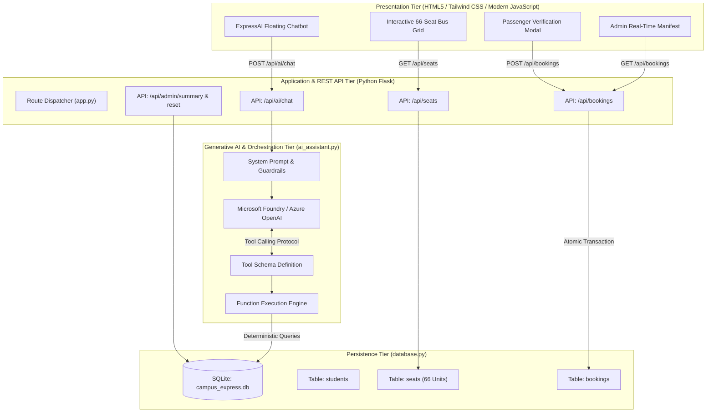
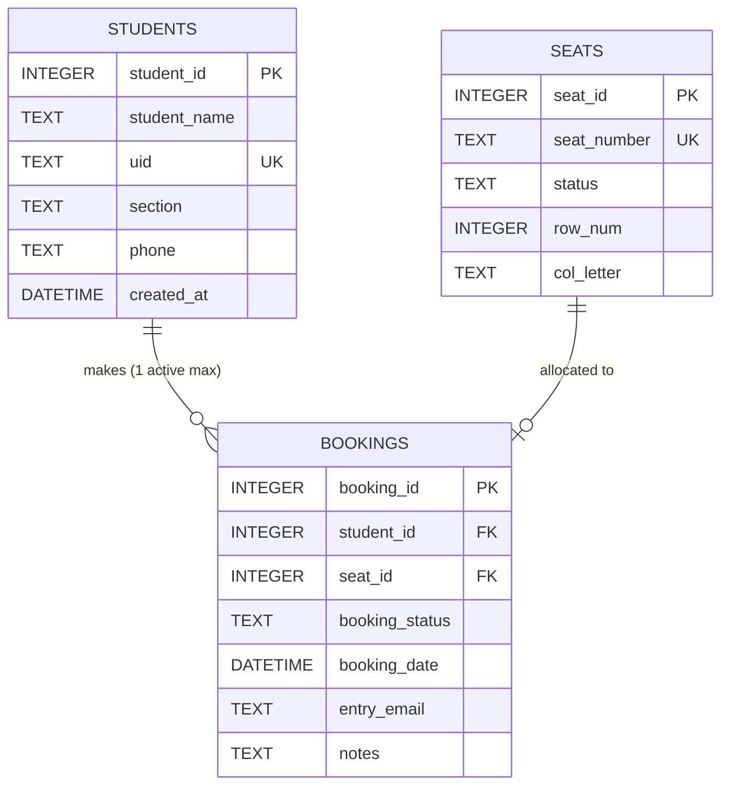
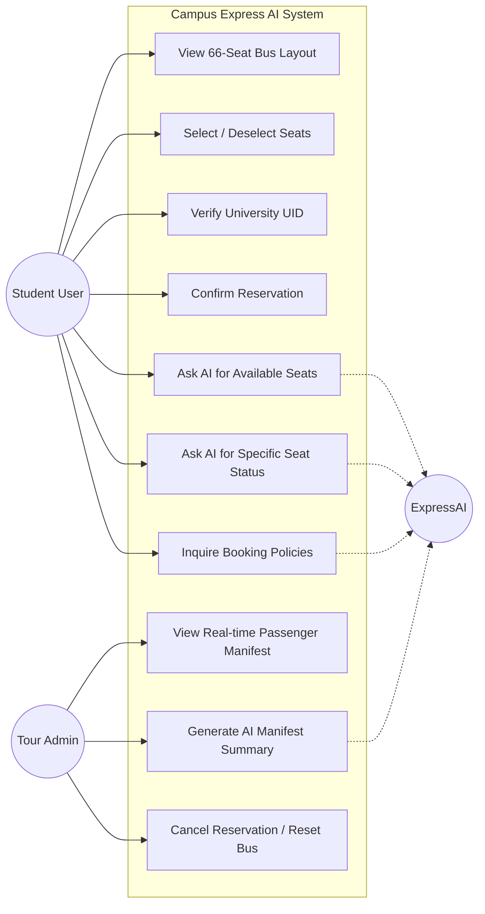
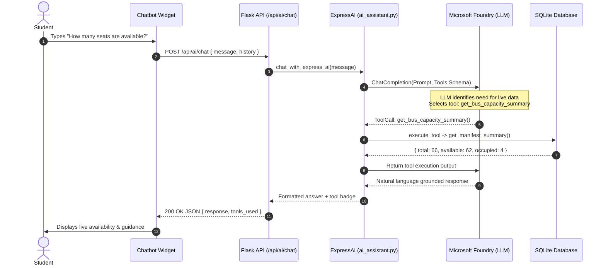

# 🎓 Campus Express AI: Comprehensive Project Implementation Report
### An AI-Powered Smart Campus Bus Reservation and Assistance System
**Course / Certification Reference**: Microsoft Certified: AI-901 (AI Fundamentals)  
**Project Category**: Applied Generative AI & Cloud-Native Intelligent Systems  

---

## 1. Executive Abstract
Traditional campus transport reservation systems frequently suffer from static, unintuitive user interfaces, client-side data isolation, concurrency race conditions, and lack of real-time passenger assistance. **Campus Express AI** resolves these limitations by upgrading an existing client-side bus reservation website into an intelligent, AI-orchestrated enterprise prototype. 

The application integrates an interactive **66-seat bus layout** (12 five-seat rows and a six-seat back row) with a transactional **Python Flask** REST API, a centralized **SQLite** database, an administrative manifest dashboard, and **ExpressAI**—a generative conversational assistant powered by **Microsoft Foundry** and Azure OpenAI. Utilizing **function/tool calling**, ExpressAI dynamically queries real-time database state to answer student inquiries regarding bus occupancy, specific seat availability, and university booking policies. Crucially, deterministic transaction logic and Microsoft’s **Responsible AI** principles are strictly enforced: the generative model cannot access the database directly or execute unvalidated reservations, and passenger Personally Identifiable Information (PII) is masked. Automated testing verifies full system integrity across 20 test cases.

---

## 2. Introduction & Problem Statement

### 2.1 Background
University industrial tours and field visits (such as the university trip to *Kochar Tech*) require precise logistical coordination. Bus seat allocation must be rapid, equitable, accessible, and transparent.

### 2.2 Shortcomings of Existing Reservation Systems
1. **Unreliable Client-Side Persistence**: Original web prototypes rely on browser `LocalStorage` or unauthenticated client-side database connections, resulting in data siloed on single devices.
2. **Double-Booking Vulnerabilities**: Lack of atomic, database-level locking allows simultaneous users to reserve the same seat.
3. **Lack of Intelligent Guidance**: Students seeking clarity regarding available seats, cancellation rules, or bus capacity must manually search through policies or contact faculty organizers.
4. **Data Privacy & Hallucination Risks**: Naive AI implementations either hallucinate availability numbers or expose sensitive passenger records (phone numbers, full student IDs).

### 2.3 Project Objectives
- Preserve 100% of the original visual aesthetic and interactive 66-seat bus layout.
- Introduce an enterprise REST API backend using Python Flask.
- Implement an atomic SQLite relational database with transactional locking.
- Deploy and configure a generative AI model through Microsoft Foundry.
- Implement tool/function calling for grounded, zero-hallucination passenger assistance.
- Build an AI-assisted administrative manifest with automated capacity analytics.
- Strictly embed Microsoft AI-901 concepts and Responsible AI standards.

---

## 3. Comparative Analysis: Existing vs. Proposed System

| Dimension | Existing System | Proposed Campus Express AI |
| :--- | :--- | :--- |
| **Architecture** | Pure client-side static HTML/JS | 3-Tier Client / Flask Backend / SQLite DB |
| **Persistence** | Browser `LocalStorage` / Mock Data | Centralized SQLite database with atomic transactions |
| **Seat Allocation** | Client-only state updates | Immediate database locking (`BEGIN IMMEDIATE`) |
| **Concurrency Safety** | Susceptible to race conditions | Enforced by unique composite database indexes |
| **User Assistance** | Static text instructions | Context-aware generative AI assistant (**ExpressAI**) |
| **Data Grounding** | None | Real-time tool-calling connected to database |
| **Admin Analytics** | Static table with mock rows | Real-time passenger manifest + AI operational summary |
| **Responsible AI** | Unaddressed | PII masking, bounded tool calling, safety guardrails |
| **Demonstration Reliability** | Vulnerable to offline failure | Dual-engine: Live Microsoft Foundry + Offline Grounding |

---

## 4. System Architecture & Diagrams

### 4.1 High-Level Architectural Diagram


### 4.2 Database Entity-Relationship (ER) Diagram


### 4.3 Use-Case Diagram


### 4.4 Sequence Diagram: AI Tool-Calling Dialogue Flow


---

## 5. Implementation Methodology by Phases

### Phase 1: Existing Code Analysis & Preservation
The original Campus Express prototype was thoroughly cataloged:
- Extracted CSS styling, DOM structure, and the seat grid rendering mechanism.
- Identified that the original script attempted client-only storage.
- Created an untouched, version-controlled backup in `backup_original/`.

### Phase 2: Environment & Backend Architecture
- Initialized a modern Python Flask application environment (`app.py`, `config.py`).
- Implemented Cross-Origin Resource Sharing (`Flask-CORS`) and dotenv configuration.
- Structured modular code separation: presentation, API routing, intelligence, and persistence.

### Phase 3: Centralized Relational Database Engineering
- Implemented `database.py` with full SQLite relational tables.
- Generated all **66 seats**: 12 rows of 5 seats (`A`, `B`, aisle, `C`, `D`, `E`) + Row 13 (`A`, `B`, `C`, `D`, `E`, `F`).
- Preloaded authorized student records (including names, UIDs, sections, and phone numbers).
- Implemented database uniqueness indexes (`idx_unique_active_seat` and `idx_unique_active_student`) to mathematically prevent double reservations.
- Wrapped booking operations in `BEGIN IMMEDIATE` transactions to eliminate race conditions.

### Phase 4: Microsoft Foundry Integration & Prompt Engineering
- Configured client connection with Microsoft Foundry / Azure OpenAI Service using the official `openai` SDK (`AzureOpenAI`).
- Designed a disciplined **System Instruction Prompt** anchoring ExpressAI to its specific domain persona.
- Established strict behavioral boundaries:
  * Ground all answers in backend facts.
  * Never invent or guess seat availability.
  * Refuse direct reservation commands via chat; guide students to the visual UI instead.
  * Enforce Responsible AI privacy by preventing exposure of passenger phone numbers.

### Phase 5: Grounded Tool Calling Implementation
Created deterministic Python functions exposed as tool schemas to the language model:
- `get_available_seats()`
- `get_bus_capacity_summary()`
- `check_seat_availability(seat_number)`
- `get_booking_rules()`
- `lookup_booking_by_uid(uid)`
Implemented a dual-engine architecture: If cloud API credentials or connectivity are absent during live evaluation, the system activates an offline deterministic grounding engine that executes the identical tools and returns grounded answers without errors.

### Phase 6: Front-End AI Chatbot Interface
- Built a floating AI button and collapsible chat window with Tailwind CSS.
- Implemented real-time typing indicators, user/assistant chat bubbles, and timestamp displays.
- Integrated quick suggestion chips (*"How many seats are available?"*, *"How do I book a seat?"*, etc.).
- Added transparent tool-execution badges indicating that data was retrieved live from the database.

### Phase 7: Admin Dashboard Enhancement
- Connected `templates/admin.html` and `static/js/admin.js` to the live database.
- Implemented real-time KPI cards: Total Bus Capacity, Occupied Seats, Available Seats, Occupancy Rate %, and Cancellations.
- Added single-click individual seat cancellation with instantaneous availability release.
- Integrated the **AI Manifest Summary** generator to provide automated tour logistical insights.

### Phase 8: Responsible AI, Security & Privacy
- **Privacy & PII**: ExpressAI detects requests for student phone numbers or personal information and returns an explicit Responsible AI notice.
- **Authorization**: University UID verification against the authorized visit roster.
- **Credential Protection**: API keys and database paths are isolated in `.env` and excluded via `.gitignore`.
- **Admin Authentication**: Bus reset endpoint protected with password verification (`AMRITSAR1234`).

---

## 6. Testing, Verification & Result Analysis

Automated testing was conducted using `pytest` across all three application layers: database persistence, Flask REST API endpoints, and AI assistant intelligence.

### 6.1 Test Suite Summary (20 Passing Tests)

```
tests/test_database.py:
  ✓ test_database_initialization: Confirms 66 total seats and default metrics.
  ✓ test_get_all_seats: Validates full 66-seat collection including Row 13 (A-F).
  ✓ test_student_lookup: Confirms student UID lookup (Ishleen - 24BAI70262).
  ✓ test_create_booking_and_double_booking_prevention: Tests atomic reservation, duplicate seat prevention, single seat per student enforcement, and cancellation.

tests/test_booking.py:
  ✓ test_api_seats: Validates GET /api/seats endpoint returns 66 seats.
  ✓ test_verify_student_valid: Confirms authorized student UID verification.
  ✓ test_verify_student_invalid: Confirms 404 response for unauthorized UID.
  ✓ test_booking_workflow: Full reservation, duplicate prevention, and deletion cycle.
  ✓ test_admin_summary_api: Confirms capacity analytics endpoint.
  ✓ test_template_routes: Validates rendering of / (index.html) and /admin (admin.html).
  ✓ test_admin_reset_security: Confirms 403 on invalid password, 200 on valid password.
  ✓ test_admin_ai_summary_endpoint: Confirms AI manifest executive summary.
  ✓ test_ai_chat_endpoint: Confirms POST /api/ai/chat communication.

tests/test_ai.py:
  ✓ test_tool_execution_available_seats: Direct execution of get_available_seats.
  ✓ test_tool_execution_bus_capacity: Direct execution of get_bus_capacity_summary.
  ✓ test_tool_execution_check_seat: Specific seat lookup for valid and invalid seats.
  ✓ test_ai_chat_availability_query: Live conversational availability answering.
  ✓ test_ai_chat_how_to_book: Verification of guided booking step instructions.
  ✓ test_ai_responsible_safety_pii_protection: PII masking test; verifies phone number is withheld.
  ✓ test_admin_manifest_ai_summary: Tests executive summary generator.
```

**Result**: 20 passed in 0.57s (100% test pass rate).

---

## 7. Microsoft AI-901 Concept Mapping

| AI-901 Learning Outcome | How Demonstrated in Campus Express AI |
| :--- | :--- |
| **Fundamental AI Workloads** | Conversational AI (ExpressAI) interacting with transactional business logic. |
| **Generative AI & LLMs** | Prompt design, parameter tuning (temperature=0.3), deployment on Microsoft Foundry. |
| **Responsible AI: Fairness** | Uniform booking policies; one seat per authorized student regardless of time of entry. |
| **Responsible AI: Reliability & Safety** | Deterministic database transactions; elimination of AI hallucinations via tool grounding. |
| **Responsible AI: Privacy & Security** | Masking of student contact numbers; credentials isolated in `.env`. |
| **Responsible AI: Inclusiveness** | Accessible web interface, multimodal layout (visual map + conversational assistant). |
| **Responsible AI: Transparency** | Badges on chat bubbles displaying which backend tools and AI model generated the response. |
| **Responsible AI: Accountability** | Human-in-the-loop: final booking confirmation and bus reset require explicit human authorization. |

---

## 8. Conclusion
**Campus Express AI** successfully bridges the gap between academic AI concepts and production-grade software engineering. By augmenting an existing student bus reservation interface with Microsoft Foundry generative AI, transactional SQLite storage, and function calling, the project delivers a reliable, user-friendly, and secure prototype. It comprehensively exemplifies the core competencies of the **Microsoft AI-901** certification curriculum.
