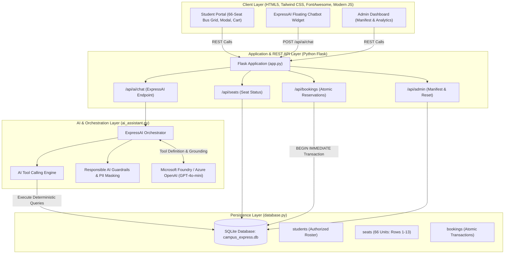

# 🚍 Campus Express AI
### An AI-Powered Smart Campus Bus Reservation & Assistance System
**Microsoft Certified: AI-901 (AI Fundamentals) Working Prototype**

---

## 📌 1. Project Overview
**Campus Express AI** upgrades the conventional university bus booking platform into an intelligent, Generative AI-powered smart transport reservation ecosystem. Developed as an end-to-end working prototype for **Microsoft AI-901**, this project integrates **Microsoft Foundry (Azure OpenAI / Generative AI)** with a transactional **Python Flask** backend, a centralized **SQLite** database, an interactive **66-seat bus layout**, and an administrative analytics manifest.

At the heart of the system is **ExpressAI**, an intelligent conversational assistant capable of **function calling (AI tool calling)** to query real-time database state, guide students through seat selection, explain university travel policies, and generate executive operational summaries for tour coordinators—all while upholding Microsoft's **Responsible AI** principles.

---

## 🏗️ 2. System Architecture



---

## ✨ 3. Key Capabilities & Features

### 🚍 Interactive 66-Seat Bus Map
- **Preserved Design**: Exact visual aesthetic retained using Tailwind CSS.
- **Full Capacity**: 12 rows of 5 seats (`A`, `B` aisle `C`, `D`, `E`) + Row 13 back row (`A`, `B`, `C`, `D`, `E`, `F`) = **66 seats**.
- **Real-Time States**: Available (green border), Selected (rose fill), Booked (slate gray with passenger's first name).

### 🤖 ExpressAI Virtual Assistant
- **Microsoft Foundry Integration**: Connects to generative language models deployed on Microsoft Foundry (`gpt-4o-mini`, `gpt-4o`).
- **Function / Tool Calling**:
  - `get_available_seats()`: Counts and samples unreserved seats.
  - `get_bus_capacity_summary()`: Live total, booked, available, and occupancy %.
  - `check_seat_availability(seat_number)`: Instant seat lookup (e.g. `1A`, `13F`).
  - `get_booking_rules()`: University travel policies and limits.
  - `lookup_booking_by_uid(uid)`: Student reservation verification.
- **Responsible AI Safeguards**:
  - Grounded in backend truths (zero hallucinations).
  - PII masking (never exposes passenger contact numbers or unauthorized personal data).
  - Safe guidance (cannot make unconfirmed reservations directly).

### 🛡️ Transactional Backend & Database
- **Centralized SQLite Database**: Replaces client-side LocalStorage and insecure Firebase rules.
- **Double-Booking Prevention**: Database-level constraints and `BEGIN IMMEDIATE` transactions prevent race conditions.
- **One-Seat-Per-Student Rule**: Strict verification ensures an authorized student UID can only book one confirmed seat.
- **Student Roster Verification**: Auto-populates names for pre-authorized student UIDs.

### 📊 Real-Time Admin Dashboard
- **Live Passenger Manifest**: Full manifest view with seat number, passenger name, UID, section, phone, and booking timestamp.
- **Real-Time Stat Counters**: Bus Capacity (66), Occupied Seats, Available Seats, Occupancy Rate %, and Cancellations.
- **Single-Click Cancellation**: Individual seat release with instant status updates.
- **AI-Assisted Operational Brief**: Generates an intelligent executive summary for faculty and tour coordinators.
- **Protected Bus Reset**: Administrator-session protected one-click reset for next journeys.

---

## 📁 4. Project Directory Structure

```
Campus-Express-AI/
├── app.py                     # Flask REST application & routing
├── database.py                # SQLite schema, seeds & transactional queries
├── ai_assistant.py            # Microsoft Foundry, ExpressAI & Tool Calling
├── config.py                  # Environment settings & credentials loader
├── requirements.txt           # Python dependencies
├── .env                       # Local environment variables
├── .env.example               # Template for environment configuration
├── .gitignore                 # Version control exclusions
│
├── database/
│   └── campus_express.db      # SQLite database file (auto-generated)
│
├── templates/
│   ├── index.html             # Student booking portal & ExpressAI widget
│   └── admin.html             # Administrative dashboard & manifest
│
├── static/
│   ├── css/
│   │   └── style.css          # Custom styling, animations & scrollbars
│   ├── js/
│   │   ├── booking.js         # Bus grid rendering, cart & REST booking
│   │   ├── chatbot.js         # ExpressAI chat widget & prompt suggestions
│   │   └── admin.js           # Admin table, AI summary & bus reset
│   └── assets/
│
├── tests/
│   ├── test_database.py       # Database schema & transaction unit tests
│   ├── test_booking.py        # Flask API endpoints & booking logic tests
│   └── test_ai.py             # ExpressAI tool calling & Responsible AI tests
│
├── backup_original/           # Backup of original client-side prototype
├── PROJECT_REPORT.md          # Comprehensive academic report & AI-901 mappings
├── VIVA_PREPARATION.md        # Viva voce questions, answers & presentation script
└── README.md                  # Project documentation
```

---

## 🚀 5. Quick Start & Execution Guide

### Prerequisites
- Python 3.9+ (Python 3.11 - 3.14 recommended)
- A modern web browser (Edge, Chrome, Firefox)

### Step 1: Clone or Navigate to Directory
```powershell
cd c:\Users\ishle\Downloads\Bus-Seat-Booking-System-Website-main
```

### Step 2: (Optional) Set up Virtual Environment
```powershell
python -m venv venv
venv\Scripts\activate
```

### Step 3: Install Required Dependencies
```powershell
pip install -r requirements.txt
```

### Step 4: Configure Microsoft Foundry Credentials (Optional)
The system includes an **Intelligent Offline Grounding Engine** that functions 100% out of the box even without cloud credentials. To connect directly to your live Microsoft Foundry deployment, edit `.env`:
```env
SECRET_KEY=generate-a-random-value-at-least-32-characters
ADMIN_PASSWORD=choose-a-unique-password-at-least-16-characters
AZURE_OPENAI_API_KEY=your_azure_foundry_api_key
AZURE_OPENAI_ENDPOINT=https://your-resource-name.openai.azure.com/
AZURE_OPENAI_DEPLOYMENT=gpt-4o-mini
AZURE_OPENAI_API_VERSION=2024-08-01-preview
```
Keep `.env` private and never commit real secrets. The public admin dashboard requires the `ADMIN_PASSWORD` configured in the environment.

### Step 5: Run Automated Tests
Verify all database, booking API, and AI assistant test cases:
```powershell
python -m pytest tests/
```
*(All 20 unit tests should pass in under 1 second!)*

### Step 6: Start the Flask Application
```powershell
python app.py
```

### Azure App Service (Linux)

Use the Python runtime, install dependencies from `requirements.txt`, and set the startup command:
```sh
gunicorn --bind=0.0.0.0:8000 --timeout 600 app:app
```

Configure these App Service environment settings:
- `SECRET_KEY`: random value of at least 32 characters.
- `ADMIN_PASSWORD`: unique value of at least 16 characters.
- `DATABASE_PATH`: `/home/campus-express.db` for persistent SQLite storage.
- `SCM_DO_BUILD_DURING_DEPLOYMENT`: `true`.

The app refuses to start on App Service if the required security settings are missing or too short. Use Azure App Settings for secrets; do not commit them to the repository.

### PythonAnywhere Beginner (Free)

PythonAnywhere's Beginner plan supports one Flask web app and keeps files in the account's home directory. The free plan has restricted outbound internet access, so ExpressAI uses its grounded fallback unless the configured AI endpoint is reachable.

1. Clone this repository in a PythonAnywhere Bash console and install `requirements.txt` in a virtualenv.
2. Create a manual Python web app using the same Python version as the virtualenv.
3. Point the WSGI file at this repository and import `app` as `application`.
4. In the WSGI file, set `APP_ENV` to `production`, `SECRET_KEY` to a unique value of at least 32 characters, `ADMIN_PASSWORD` to a unique value of at least 16 characters, and `DATABASE_PATH` to a path under `/home/<username>/`.
5. Reload the web app. The app refuses to start in production if the required secrets are missing or too short. Keep them out of GitHub.

### Step 7: Open in Browser
- **Student Booking Portal**: [http://127.0.0.1:5000](http://127.0.0.1:5000)
- **Admin Dashboard**: [http://127.0.0.1:5000/admin](http://127.0.0.1:5000/admin) *(sign in with the configured administrator password)*

---

## 📡 6. REST API Reference

| Endpoint | Method | Description |
| :--- | :--- | :--- |
| `GET /` | `GET` | Serves the main student reservation portal |
| `GET /admin` | `GET` | Serves the administrator dashboard |
| `GET /api/seats` | `GET` | Returns all 66 seats and their live statuses |
| `GET /api/seats/<id>` | `GET` | Returns status for a single seat (e.g. `1A`) |
| `GET /api/students/verify/<uid>` | `GET` | Verifies student UID against official roster |
| `GET /api/bookings` | `GET` | Returns all active reservations for the manifest |
| `POST /api/bookings` | `POST` | Atomically books one or more seats |
| `DELETE /api/bookings/<id>` | `DELETE` | Cancels a reservation and frees the seat |
| `GET /api/admin/summary` | `GET` | Returns capacity stats & section distribution |
| `POST /api/admin/reset` | `POST` | Resets all bookings (requires admin password) |
| `POST /api/admin/ai-summary` | `POST` | Generates AI operational summary of manifest |
| `POST /api/ai/chat` | `POST` | Communicates with ExpressAI assistant |

---

## 🎓 7. Alignment with Microsoft AI-901 Fundamentals

| AI-901 Curriculum Pillar | Project Implementation |
| :--- | :--- |
| **Generative AI Concepts** | Natural language dialogue via Microsoft Foundry LLMs (`gpt-4o-mini`) |
| **Prompt Engineering** | System prompts with strict role definitions, behavioral boundaries, and tone controls |
| **Tool / Function Calling** | Model dynamically issues tool calls to fetch actual database facts |
| **Grounded AI (RAG)** | Elimination of hallucinations through deterministic live database context injection |
| **Responsible AI (Fairness, Reliability, Safety, Privacy, Inclusiveness, Transparency)** | PII masking (phones hidden), concurrency safety, transparent tool-execution badges |
| **Evaluation & Quality** | 20 unit tests across database transactions, API security, and safety boundaries |

---

## 👥 8. Author & Academic Credits
- **Project**: Campus Express AI
- **Demonstration**: Microsoft AI-901 Certified Working Prototype
- **Original Front-End**: Campus Express Bus Reservation Platform
